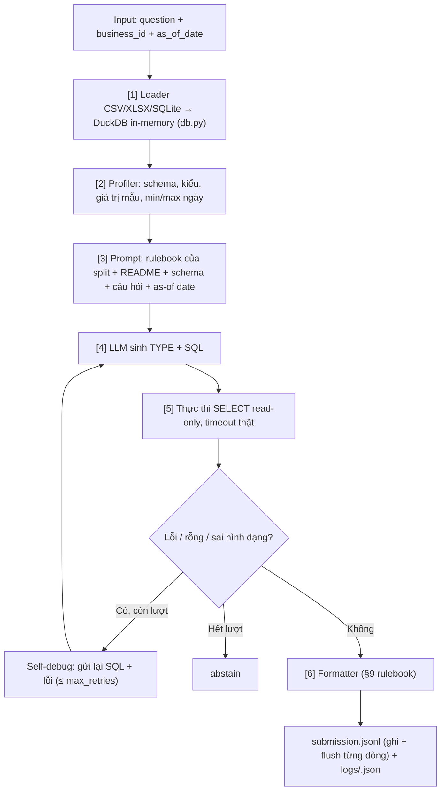

# DataMate — AI Agent for Tabular Data QA (Zalo AI Challenge 2026)

Hệ thống AI Agent trả lời câu hỏi ngôn ngữ tự nhiên bằng tiếng Việt trên dữ liệu bảng (CSV, XLSX đa sheet/đa file, SQLite).

---

## 1. Mô hình và Ràng buộc cuộc thi

- **Môi trường Dev (MacBook M-series)**: Qwen2.5-7B / Qwen3-8B qua **Ollama** REST API (`http://localhost:11434`)
- **Môi trường Nộp bài (2×RTX 5090)**: Qwen2.5-14B-Instruct / Qwen3-14B qua **vLLM** (Tensor Parallelism = 2)
- **Giới hạn tham số**: ≤ 15B tham số, chạy hoàn toàn offline (không gọi API bên ngoài)
- **Thời gian suy luận**: Xử lý toàn bộ test set trong vòng dưới 3–4 tiếng (giới hạn tối đa 6 tiếng)

---

## 2. Kiến trúc Pipeline

Pipeline có hai chế độ, chọn bằng `agent.mode` trong config:

- **`sql`** (mặc định trong `configs/*.yaml`, baseline Giai đoạn 1 của `plan.md`): LLM viết **một câu SQL DuckDB**, mọi con số do SQL tính ra.
- **`pandas`** (chế độ cũ): LLM viết code pandas, chạy trong `sandbox.py`.

### 2.1 Chế độ `sql`



### 2.2 Các module chính
- **`src/datamate/loader.py`**: Đọc CSV (tự dò encoding/dấu phân cách), XLSX (dò dòng header, bỏ dòng Tổng/Total, bỏ dòng header bị lặp trong dữ liệu, gộp các sheet cùng cột thành một bảng có cột `sheet`, nối các file tháng thành bảng `BanHang`), SQLite. Chuẩn hoá ngày tiếng Việt, ngày dạng số serial Excel và số. Truyền `keep_time=True` (chế độ `sql` luôn bật) để giữ giờ `HH:MM:SS`, cần cho câu hỏi giờ cao điểm và ca sáng/chiều.
- **`src/datamate/db.py`**: Nạp các bảng vào DuckDB in-memory, đổi tên bảng/cột sang không dấu snake_case (`Ngày đặt hàng` → `ngay_dat_hang`; tên gốc ghi trong schema). Chỉ ép kiểu DATE/TIMESTAMP/số khi **mọi** giá trị khớp, giữ số 0 ở đầu (số điện thoại, mã), tách cột `"1 ly"` thành `<cot>_so` và `<cot>_don_vi`. Tạo schema text cho prompt: các giá trị khi cột có ≤ 25 giá trị khác nhau, min/max với cột số và cột ngày. Kèm bảng `lich` (lịch âm–dương của split). Chỉ cho chạy đúng một câu SELECT, tắt truy cập file (`enable_external_access=false`), có timeout bằng `interrupt()` và mặc định chạy 1 thread để kết quả tái lập được.
- **`src/datamate/sql_agent.py`**: Dựng prompt (phần tĩnh đặt trước để server LLM dùng lại cache prefix), tách `TYPE` và SQL từ câu trả lời, chạy self-debug và chuyển DataFrame kết quả thành đáp án theo type.
- **`src/datamate/rules.py`**: Đọc `rulebook.md` **của split đang chạy** (tìm ở `<split>/rulebook.md`, hoặc đi ngược lên từ thư mục business).
- **`src/datamate/profiler.py`**, **`time_resolver.py`**, **`entity_linker.py`**, **`sandbox.py`**, **`agent.py`**: dùng cho chế độ `pandas` (chế độ `sql` chưa dùng time resolver và entity linker).
- **`src/datamate/formatter.py`**: Định dạng đáp án theo rulebook §9 (number, percent, date, boolean, string, list, table, unanswerable, abstain).
- **`src/datamate/llm.py`**: Dual backend wrapper (Ollama cho Mac, vLLM cho production GPU).
- **`src/datamate/runner.py`**: Vòng lặp chính. Xử lý câu hỏi theo nhóm business, ghi `submission.jsonl` từng dòng kèm flush, ghi log từng câu và chuyển sang abstain khi có lỗi.
- **`scripts/evaluate.py`**: Chấm điểm theo công thức Penalized Accuracy (PA = (correct − wrong) / N; đúng +1, sai −1, abstain 0).
- **`scripts/validate_submission.py`**: Kiểm tra định dạng `submission.jsonl` trước khi nộp.

---

## 3. Cài đặt và Chạy

### 3.1 Cài đặt môi trường
```bash
python3 -m venv .venv
source .venv/bin/activate          # Windows: .venv\Scripts\activate
pip install -r requirements.txt    # cần pandas >= 2.0, duckdb >= 1.1
```

### 3.2 Chuẩn bị LLM (dev, Ollama)
```bash
# Cài Ollama: https://ollama.com, rồi:
ollama pull qwen2.5:7b
ollama serve                       # nếu Ollama chưa chạy nền
curl http://localhost:11434/api/tags   # kiểm tra server đã lên
```
Prompt của chế độ `sql` dài khoảng **23k–47k ký tự** (đo trên 14 business của public_test), vì chứa toàn bộ rulebook, README và schema. `configs/dev.yaml` đặt `num_ctx: 32768`. Nếu prompt vượt context, `llm.py` in cảnh báo `[LLM Warning] prompt filled num_ctx`. Khi thấy cảnh báo này thì tăng `num_ctx` (tốn thêm RAM/VRAM). Số token thực tế phụ thuộc tokenizer, nên hãy xem `prompt_eval_count` trong lần chạy đầu.

### 3.3 Chạy bộ test unit
```bash
PYTHONPATH=. pytest tests/
```
Các test không cần LLM: phần LLM được thay bằng một LLM giả trả lời theo kịch bản.

### 3.4 Chạy thử vài câu, xem log
```bash
python src/datamate/runner.py -c configs/dev.yaml -d train --limit 10 -o outputs/train_10/submission.jsonl
```
- Mỗi câu có một file `outputs/train_10/logs/<id>.json` gồm prompt size, câu trả lời thô của LLM, SQL từng lượt, lỗi, kết quả SQL (5 dòng đầu), đáp án cuối và thời gian. Đây là chỗ đầu tiên nên xem khi một câu sai.
- Lọc một shop: thêm `--business biz_101`. Chạy không cần LLM (toàn bộ abstain): thêm `--dry-run`.

### 3.5 Đo baseline trên train (bắt buộc trước khi tối ưu)
`train/questions.jsonl` được sắp theo id nên `--limit N` lấy N câu trải đều các business. Mẫu này cố định giữa các lần chạy, dùng được để so sánh trước/sau một thay đổi.
```bash
python src/datamate/runner.py -c configs/dev.yaml -d train --limit 300 -o outputs/train_300/submission.jsonl
python scripts/evaluate.py -p outputs/train_300/submission.jsonl -g train/answers.jsonl -q train/questions.jsonl --only-predicted
```
`--only-predicted` chỉ chấm các câu đã chạy. Nếu không có cờ này, các câu chưa chạy bị tính là abstain và PA bị pha loãng.

### 3.6 Chạy public test và nộp lần đầu
```bash
# Linux/Mac (Windows: dùng Git Bash, hoặc chạy thẳng runner.py như dưới)
./predict.sh public_test outputs/public/submission.jsonl
# tương đương:
python src/datamate/runner.py -c configs/dev.yaml -d public_test -o outputs/public/submission.jsonl

# Kiểm tra định dạng trước khi nộp
python scripts/validate_submission.py -p outputs/public/submission.jsonl -q public_test/questions.jsonl
```
Validator báo `OK` thì upload `outputs/public/submission.jsonl` lên leaderboard (bước này làm thủ công). Nếu chạy bị dừng giữa chừng, file vẫn có đầy đủ các dòng đã ghi; câu thiếu được chấm là abstain.

Riêng phần nạp dữ liệu 14 business của public_test mất khoảng **4–5 phút** (đo trên máy dev, chưa tính thời gian LLM). Thời gian LLM cho mỗi câu cần đo bằng `elapsed_seconds` trong log.

### 3.7 Chạy trên server BTC (Docker)
```bash
./predict.sh /data /result/submission.jsonl    # tự chọn configs/prod.yaml; log ghi vào /result/logs/
```
Docker image chưa được dựng (Giai đoạn 6 của `plan.md`). Nhánh vLLM trong `llm.py` cũng chưa được chạy thử.

### 3.8 Các tham số config quan trọng (`configs/dev.yaml`)
| Khoá | Ý nghĩa |
|---|---|
| `agent.mode` | `sql` hoặc `pandas` |
| `agent.max_retries` | số lượt self-debug sau lượt đầu |
| `agent.sandbox_timeout` | timeout (giây) cho mỗi câu SQL |
| `agent.on_llm_unanswerable` | khi LLM nói không trả lời được: nộp `unanswerable` hay `abstain`. Trả `unanswerable` sai bị −1, `abstain` được 0, nên hãy so hai lựa chọn bằng 3.5 |
| `agent.sql_threads` | số thread DuckDB; `1` để tái lập (Rule 8) |
| `llm.num_ctx` | context của Ollama, phải lớn hơn độ dài prompt |
| `runner.group_by_business` | xử lý câu theo business để dùng lại dữ liệu và cache prefix của prompt |
