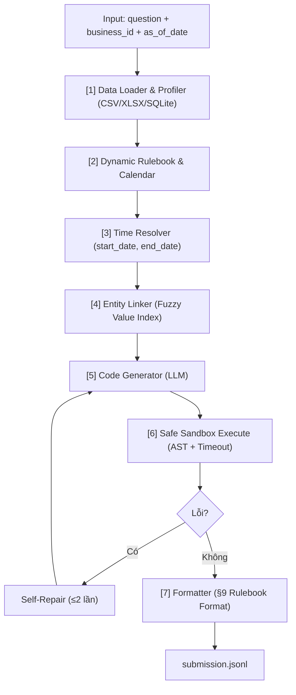

# DataMate — AI Agent for Tabular Data QA (Zalo AI Challenge 2026)

Hệ thống AI Agent trả lời câu hỏi ngôn ngữ tự nhiên bằng tiếng Việt trên dữ liệu bảng (CSV, XLSX đa sheet/đa file, SQLite).

---

## 1. Mô hình và Ràng buộc cuộc thi

- **Môi trường Dev (MacBook M-series)**: Qwen2.5-7B / Qwen3-8B qua **Ollama** REST API (`http://localhost:11434`)
- **Môi trường Nộp bài (2×RTX 5090)**: Qwen2.5-14B-Instruct / Qwen3-14B qua **vLLM** (Tensor Parallelism = 2)
- **Giới hạn tham số**: ≤ 15B tham số, chạy hoàn toàn offline (không gọi API bên ngoài)
- **Thời gian suy luận**: Xử lý toàn bộ test set trong vòng dưới 3–4 tiếng (giới hạn tối đa 6 tiếng)

---

## 2. Kiến trúc Pipeline



### Các module chính:
- **`src/datamate/loader.py`**: Tự động nhận diện và đọc CSV, XLSX (bù offset header, lọc dòng Tổng/Total, nối các file tháng thành bảng `BanHang`), SQLite. Chuẩn hóa ngày tiếng Việt và số.
- **`src/datamate/profiler.py`**: Trích xuất schema card và tạo `ValueIndex` cho fuzzy search.
- **`src/datamate/time_resolver.py`**: Phân tích biểu thức thời gian tiếng Việt (hôm qua, tháng này, tuần trước, quý 4/2025, Tết Nguyên Đán tra từ `calendar.csv`) thành `(start_date, end_date)` chính xác.
- **`src/datamate/entity_linker.py`**: Fuzzy matching tên sản phẩm, danh mục, khách hàng từ câu hỏi với `ValueIndex` bằng RapidFuzz.
- **`src/datamate/sandbox.py`**: Chạy code pandas an toàn trong thread riêng, kiểm tra AST cấm module nguy hiểm (`os`, `sys`, `subprocess`), giới hạn thời gian chạy.
- **`src/datamate/formatter.py`**: Định dạng đáp án tuân thủ nghiêm ngặt rulebook §9 (number, percent, date, boolean, string, list, table, unanswerable, abstain).
- **`src/datamate/llm.py`**: Dual backend wrapper (Ollama cho Mac, vLLM cho production GPU).
- **`scripts/evaluate.py`**: Chấm điểm chuẩn xác công thức Penalized Accuracy (PA = (correct - wrong) / N; đúng +1, sai -1, abstain 0).

---

## 3. Cài đặt và Chạy

### 3.1 Cài đặt môi trường
```bash
python3 -m venv .venv
source .venv/bin/activate
pip install -r requirements.txt
```

### 3.2 Chạy bộ test unit
```bash
PYTHONPATH=. pytest tests/
```

### 3.3 Chạy Agent
Chạy qua script entrypoint:
```bash
./predict.sh [path/to/data] [path/to/submission.jsonl]
```

Hoặc chạy trực tiếp với runner:
```bash
# Chạy trên tập train với config dev (Ollama)
python src/datamate/runner.py --config configs/dev.yaml --data-dir train --output submission.jsonl

# Chạy thử nghiệm nhanh 10 câu đầu
python src/datamate/runner.py --config configs/dev.yaml --data-dir train --limit 10 --output test_10.jsonl
```

### 3.4 Chấm điểm
```bash
python scripts/evaluate.py -p submission.jsonl -g train/answers.jsonl -q train/questions.jsonl
```
